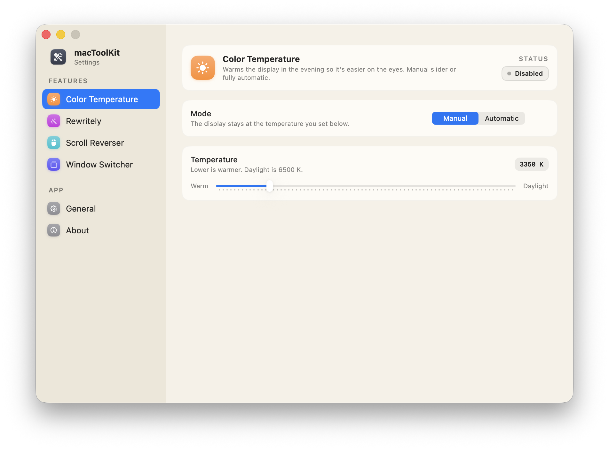
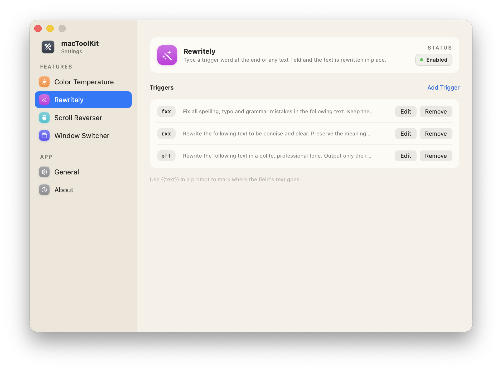
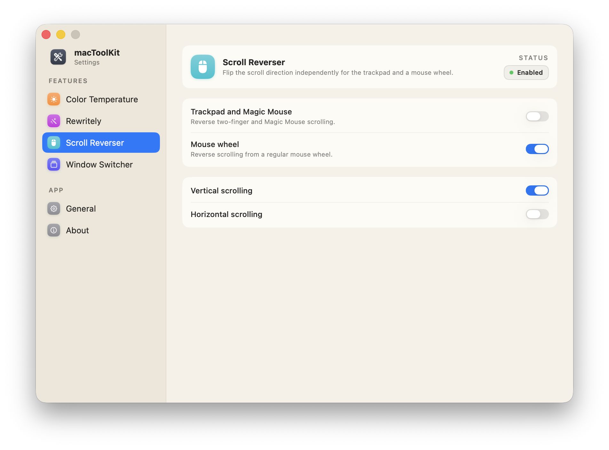
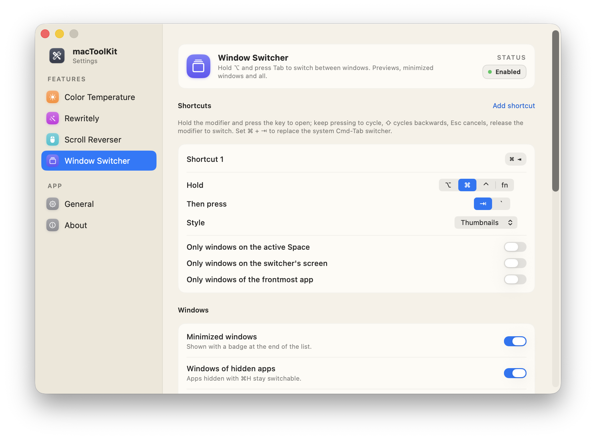
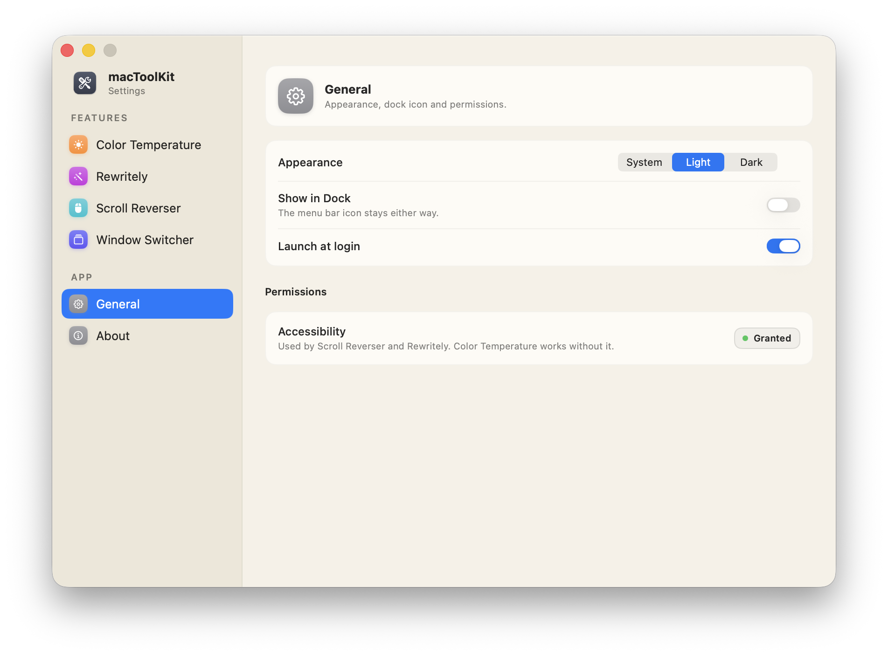

# macToolKit

Menu bar toolkit for macOS 26+ (Apple Silicon). Twelve tools, individually
toggled from the menu bar icon (Peek is a Quick Look extension
that macOS manages). The menu and the Settings sidebar group them by what
they act on: Windows, Mouse & Keyboard, Finder and System. General settings cover appearance (System/Light/Dark), an
optional dock icon ("Show in Dock") and launch at login.

## Features

| Group | Feature | Permission | Notes |
|---|---|---|---|
| Windows | Window Switcher | Accessibility (+ Screen Recording for thumbnails) | Alt-Tab style switcher; thumbnails, app icons or titles; per-shortcut slots |
| Windows | Quit on Close | Accessibility | Closing an app's last window quits it; minimized windows, other Spaces and tab groups count; keep-running list |
| Windows | Maximize Windows | Accessibility | The green button fills the screen; click again to restore, ⌥-click for full screen |
| Mouse & Keyboard | Smooth Scrolling | Accessibility | A mouse wheel glides like a trackpad; glide length, speed and per-app exceptions. Trackpad and modifier+wheel untouched |
| Mouse & Keyboard | Scroll Reverser | Accessibility | Trackpad/mouse and vertical/horizontal independently |
| Mouse & Keyboard | Side Buttons | Accessibility | Mouse buttons 4 and 5 go back and forward via a navigation swipe; per-app exceptions |
| Mouse & Keyboard | Rewritely - trigger-word AI rewrite | Accessibility | Apple Intelligence on-device; default triggers `;;fix` `;;tight` `;;prof` |
| Finder | Peek - folder and zip Quick Look | none | Press Space on a folder or a `.zip` in Finder; browsable tree with sizes, sorting and depth preload |
| Finder | Cut & Paste | Accessibility | ⌘X then ⌘V moves files in Finder |
| System | Color temperature (f.lux style) | none | Manual slider or sunset/sunrise auto mode |
| System | Audio Priority | none | Rank outputs and inputs; the highest-ranked connected device becomes the default, manual picks respected |

## Screenshots

| Color Temperature | Rewritely |
|---|---|
|  |  |

| Scroll Reverser | Window Switcher |
|---|---|
|  |  |

| General |
|---|
|  |

## Install

### Homebrew (recommended)

```sh
brew install --cask aletisunil/tap/mactoolkit
```

Or tap once, then use the short name:

```sh
brew tap aletisunil/tap
brew install --cask mactoolkit
```

Upgrade:

```sh
brew upgrade --cask mactoolkit
```

Uninstall:

```sh
brew uninstall --zap --cask mactoolkit  # app, settings and caches
```

### Manual

Download the latest `macToolKit.dmg` from
[Releases](https://github.com/aletisunil/macToolKit/releases), open it and
drag macToolKit to Applications. The app is Developer ID signed and
notarized — no Gatekeeper warnings.

After installing either way, see [First-run setup](#first-run-setup) for the
Accessibility permissions each tool needs.

### Uninstalling

Homebrew installs: `brew uninstall --zap --cask mactoolkit`, which takes the
app, its settings and its caches, and Homebrew's own receipt with it.

Manual installs: turn **Launch at login** off in Settings → General, quit
macToolKit, and drag it from Applications to the Trash. The Peek Quick Look
extension ships *inside* the app bundle, so it goes at the same time; its row in
System Settings disappears whenever LaunchServices next rescans.

Settings live outside the bundle and stay behind. To clear them:

```sh
rm -rf ~/Library/Group\ Containers/5432YAY2UX.com.sunilaleti.mactoolkit
rm -f ~/Library/Preferences/com.sunilaleti.mactoolkit.plist
```

Accessibility and Screen Recording grants have to be removed by hand in System
Settings — no app can revoke its own TCC entries.

## Build

```sh
brew install xcodegen   # once
xcodegen generate
xcodebuild -project macToolKit.xcodeproj -scheme macToolKit -configuration Debug build
```

Run the tests with:

```sh
xcodebuild -project macToolKit.xcodeproj -scheme macToolKit -configuration Debug test
```

The window, mouse and Finder features have an end-to-end run that posts real
HID events through the Debug build and checks the outcome in Finder, Preview
and the app's log (about two minutes; it moves the pointer, so leave the Mac
alone). It needs a shell with Accessibility access and writes a PASS/FAIL
report:

```sh
Scripts/e2e/input-features.sh
```

Signing uses the local "Apple Development" identity (team 5432YAY2UX, set in
project.yml). The app and the Quick Look extension share a team-prefixed app
group (`5432YAY2UX.com.sunilaleti.mactoolkit`, `APP_GROUP_ID` in project.yml)
for the Peek settings, so no provisioning profile is needed.

## Releasing

Push a version tag and CI builds, signs, notarizes and publishes a `.dmg` +
`.zip` to GitHub Releases (see `.github/workflows/release.yml`):

```sh
git tag v1.0.0
git push origin v1.0.0
```

Local release build: `Scripts/release.sh 1.0.0` (needs the Developer ID
certificate and a saved `notarytool` keychain profile named `macToolKit`).

## First-run setup

1. **Accessibility** - needed by every Windows and Mouse & Keyboard tool and
   by Cut & Paste; grant from Settings → General when prompted.
2. **Screen Recording** - optional, only for Window Switcher thumbnails;
   without it the switcher falls back to app-icon tiles.
3. **Rewritely** - requires Apple Intelligence enabled in System Settings.
4. Auto color temperature can use Location (optional) or fixed times.

## How Rewritely works

Type a trigger word at the very end of any text field (e.g.
`fix this sentnce pls ;;fix`). The app reads the field via Accessibility,
strips the trigger, runs your per-trigger prompt (`{{text}}` = the field text)
through the on-device model, and replaces the text in place. Fields without a
settable AX value (some Electron/web views) use a clipboard fallback that
selects to the start of the field so text after the trigger is preserved.

## Architecture notes

- `macToolKit/` — main app (non-sandboxed). `Features/` one folder per tool.
- Gamma tables (`CGSetDisplayTransferByTable`) are reset by macOS on wake and
  display changes; `ColorTemperatureController` reapplies automatically and
  `CGDisplayRestoreColorSyncSettings()` restores on disable/quit.
- Event taps run on dedicated threads. `Support/EventTap.swift` is the shared
  lifecycle (thread, permission wait, 2 s watchdog) for the scroll tap, Side
  Buttons, Maximize Windows and Cut & Paste; the Window
  Switcher has its own. Rewritely's listen-only tap stays on the main run
  loop. All of them recover from `tapDisabledByTimeout` both in the callback
  and from the watchdog, since the disable notification itself can be missed.
- Scroll Reverser and Smooth Scrolling share one tap (`Features/Scrolling`),
  so an event is always reversed first and smoothed second. A glide is
  posted at the session level as phase-less pixel events, one per display
  frame from a `CADisplayLink` on its own thread: phased events make AppKit
  add its own momentum, so the distance would no longer be exact. Modifier +
  wheel passes through raw - AppKit only turns ⇧ + wheel sideways for
  line-based events.
- "Which window is under the pointer" is the window server's hit test
  (`SLSFindWindowAndOwner`, `Support/WindowHitTest.swift`), not a walk of
  `CGWindowListCopyWindowInfo`: the Dock keeps a transparent, screen-sized
  window above every app that only takes clicks over the Dock itself.
- Maximize Windows only hit-tests a click with Accessibility when it lands in
  the traffic-light corner of a window. An Accessibility query into Chrome or
  an Electron app switches on its whole accessibility tree, which is slow.
  It presses the app's own Window > Fill and Return to Previous Size items
  (found by their identifiers `_zoomFill:` / `_zoomUntile:`, which don't
  change with the language), so the window animates like a system tile; it
  only sets the frame itself for apps without them. It also closes the green
  button's hover menu, which a swallowed click would otherwise leave open.
  Messaging timeouts go on app elements only: one set on the system-wide
  element becomes the default for every element in the process.
- Side Buttons post a synthetic navigation swipe (gesture events with
  undocumented fields) rather than ⌘[ / ⌘], which means "outdent" in editors.
- Cut & Paste replaces ⌘X with a freshly built ⌘C and adds ⌥ to the next ⌘V
  (Finder's "Move Item Here"). Editing a key event's code doesn't work - AppKit
  matches shortcuts on the characters the event was created with - and key
  events built off the main thread carry no characters until the main thread
  has loaded the keyboard layout, so the ⌘C is built there. It is posted at
  the HID level (marked, so its own tap lets it pass), behind any key still
  in another app's tap, and the clipboard is only touched on the main thread.
- Quit on Close watches each app with an AXObserver and quits only when no
  window is left anywhere: minimized windows count, and windows on other
  Spaces (invisible to Accessibility) come from the window list.
- Peek settings live in the shared app group container, which is how the
  sandboxed Quick Look extension reads what the app writes. Values from older
  builds, which used `NSGlobalDomain`, are migrated on first launch and removed
  from there.
- Peek reads a `.zip` through its central directory only
  (`Shared/ZipCentralDirectory.swift`) — two bounded reads, no decompression, so
  a multi-gigabyte archive lists as fast as a small one. Folders and archives
  reach the panel through the same `PeekContentProvider`.
- Quick Look's window chrome (the close and full-screen buttons) belongs to the
  host process, not the extension — there is no API to hide it, so the header
  inset adapts instead.
- Audio Priority listens to the *device list*, never to the default-device
  property. Watching the default would snap back every manual pick made in
  System Settings; a manual pick only loses when a ranked device is plugged in
  or removed and the winner actually moves. Devices are remembered by HAL UID
  (`AudioDeviceID` is ephemeral) and device-list events are debounced, since one
  hardware change fires several.

## License

[MIT](LICENSE)
